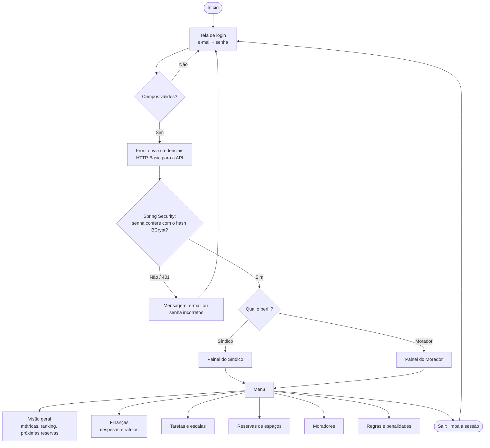
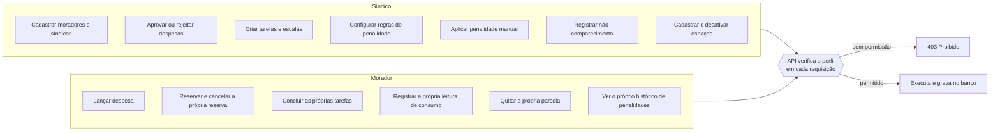
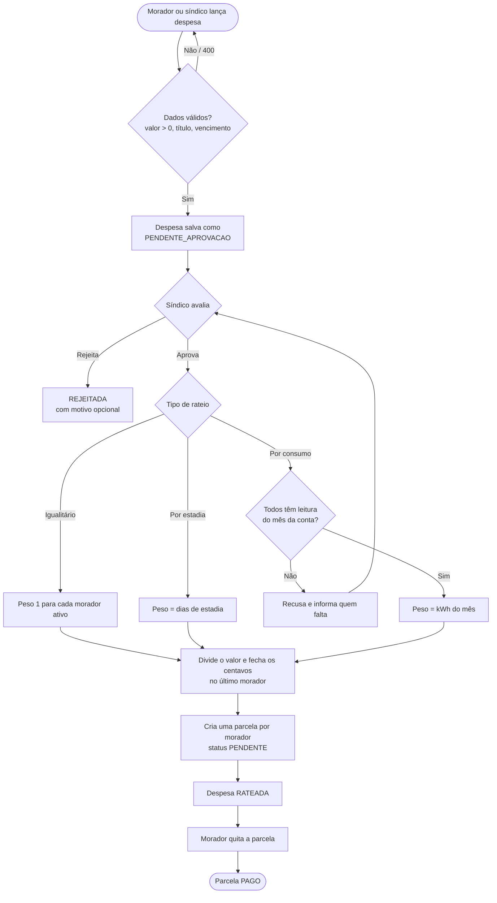
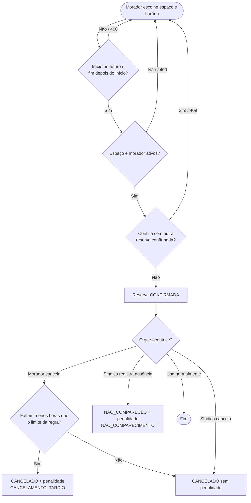
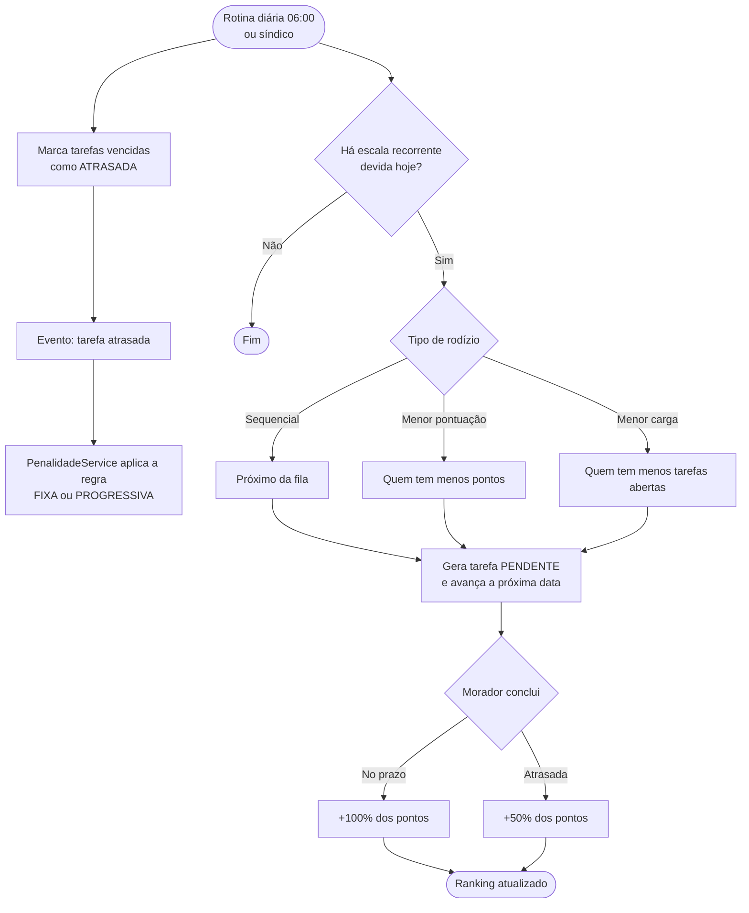

# Fluxograma: HomeLive 2050

Fluxo da aplicação do ponto de vista do usuário (front-end HTML/JS → API Spring Boot → PostgreSQL).

## 1. Fluxo geral: acesso e navegação

## 2. O que cada perfil pode fazer

## 3. Despesa e rateio

## 4. Reserva de espaço comum

## 5. Tarefas, rodízio e gamificação

