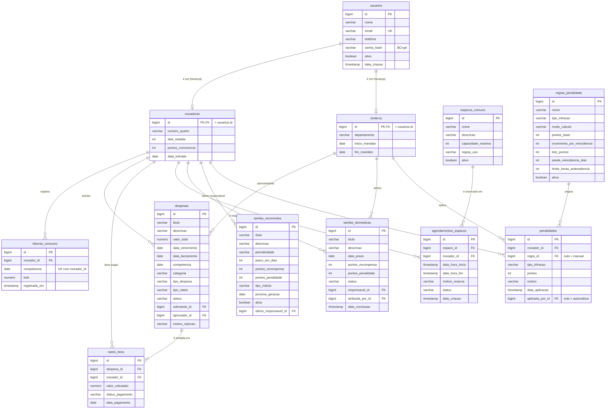

# Modelagem de Dados: HomeLive 2050

Banco relacional **PostgreSQL** (perfil `postgres`). As tabelas são geradas pelo Hibernate a partir das classes `@Entity`
do pacote `br.com.homelive.model`, então este diagrama espelha o código.

## Diagrama Entidade-Relacionamento (DER)

## Tabelas

| Tabela | Classe Java | O que guarda |
| :--- | :--- | :--- |
| `usuarios` | `Usuario` (abstrata) | Dados comuns de login de qualquer pessoa |
| `moradores` | `Morador extends Usuario` | Quarto, estadia e pontos de convivência |
| `sindicos` | `Sindico extends Usuario` | Mandato e departamento do administrador |
| `leituras_consumo` | `LeituraConsumo` | kWh de cada morador por mês (base do rateio por consumo) |
| `despesas` | `Despesa` | Contas da casa e seu ciclo de aprovação |
| `rateio_itens` | `RateioItem` | Parcela de cada morador numa despesa aprovada |
| `espacos_comuns` | `EspacoComum` | Áreas compartilhadas (escritório, lavanderia, gourmet) |
| `agendamentos_espacos` | `AgendamentoEspaco` | Reservas de espaços |
| `tarefas_domesticas` | `TarefaDomestica` | Tarefas concretas com prazo e pontos |
| `tarefas_recorrentes` | `TarefaRecorrente` | Escalas que geram tarefas automaticamente (rodízio) |
| `regras_penalidade` | `RegraPenalidade` | Regras configuradas pelo síndico |
| `penalidades` | `Penalidade` | Histórico de punições aplicadas (auditoria) |

**Herança `JOINED`:** `usuarios` tem as colunas comuns; `moradores` e `sindicos` têm só as colunas próprias e usam o
**mesmo `id`** como chave primária e estrangeira. Um morador é a junção `usuarios ⨝ moradores`.

## Regras de negócio

**Usuários e perfis**
* E-mail é único (`UNIQUE`). Senha guardada só como hash BCrypt.
* Dois perfis com permissões distintas: **Síndico** (administra) e **Morador** (usa).
* Morador não é apagado: é desativado (`ativo = false`), para preservar o histórico.
* Todo morador começa com 100 pontos de convivência.

**Despesas e rateio**
* Ciclo de vida: `PENDENTE_APROVACAO → APROVADA → RATEADA`, ou `PENDENTE_APROVACAO → REJEITADA`. Uma despesa avaliada não
  volta a ser avaliada.
* Só o síndico aprova ou rejeita (a rejeição pode registrar um motivo).
* Ao aprovar, a despesa é dividida entre os moradores ativos (`rateio_itens`) conforme `tipo_rateio`: igualitário, por
  dias de estadia ou por consumo (kWh). A soma das parcelas é sempre igual ao valor total (os centavos fecham no último).
* O rateio por consumo usa as leituras do **mês de competência** da conta. Falta leitura de algum morador → o rateio é recusado.
* Uma leitura por morador por mês (`UNIQUE (morador_id, competencia)`); registrar de novo corrige a existente.

**Reservas de espaços**
* Não se reserva no passado, com fim antes do início, nem espaço ou morador inativos.
* Não pode haver duas reservas confirmadas do mesmo espaço com horários sobrepostos:
  `inicioNovo < fimExistente AND fimNovo > inicioExistente`.
* Morador só cancela a própria reserva. Cancelar em cima da hora pode gerar penalidade.

**Tarefas e gamificação**
* Concluir no prazo dá `pontos_recompensa`; fora do prazo, 50%.
* Tarefa vencida vira `ATRASADA` e gera penalidade.
* Escalas recorrentes geram tarefas sozinhas (rotina diária às 06:00), escolhendo o responsável por rodízio
  (`SEQUENCIAL`, `MENOR_PONTUACAO` ou `MENOR_CARGA`). Gerar duas vezes no mesmo dia não duplica.

**Penalidades**
* Só uma regra ativa por tipo de infração.
* Cálculo `FIXA` (sempre `pontos_base`) ou `PROGRESSIVA` (`pontos_base + incremento × reincidências`, limitado ao teto).
* Toda penalidade fica registrada com morador, regra, pontos, motivo, data e quem aplicou.
